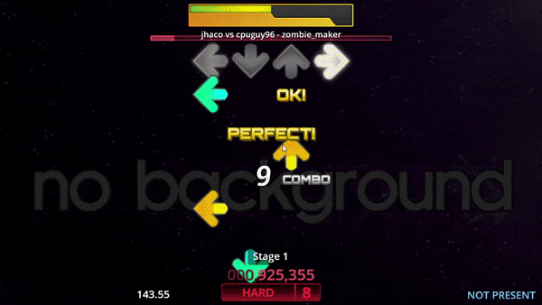

<div align="center">

# StepCOVNet



**Audio to StepMania Note Generator using Deep Learning**

[](https://github.com/cpuguy96/StepCOVNet/actions/workflows/pre-submit.yml)
[](https://app.codacy.com/gh/cpuguy96/StepCOVNet/dashboard?utm_source=gh&utm_medium=referral&utm_content=&utm_campaign=Badge_coverage)
[](https://app.codacy.com/gh/cpuguy96/StepCOVNet/dashboard?utm_source=gh&utm_medium=referral&utm_content=&utm_campaign=Badge_grade)
[](https://www.python.org/downloads/)
[](LICENSE)

</div>

---

## 📖 About

**StepCOVNet** is a deep learning project designed to automatically generate StepMania charts from audio files. It
utilizes Convolutional Neural Networks (CNNs) and Transformers to detect note onsets and predict arrow patterns,
allowing rhythm game enthusiasts to create charts for their favorite songs instantly.

## 📑 Table of Contents

- [Installation](#-installation)
- [Usage](#-usage)
  - [Generating Charts](#generating-charts)
  - [Training Models](#training-models)
    - [Data Preparation](#data-preparation)
    - [Training Onset Model](#training-onset-model)
    - [Training Arrow Model](#training-arrow-model)
- [Project Structure](#-project-structure)
- [Contributing](#-contributing)
- [Credits](#-credits)
- [License](#-license)

## 💻 Installation

1. **Clone the repository**

   ```bash
   git clone https://github.com/cpuguy96/StepCOVNet.git
   cd StepCOVNet
   ```

2. **Set up a virtual environment (Recommended)**

   ```bash
   python -m venv venv
   source venv/bin/activate  # Windows: `venv\Scripts\activate` (after `python -m venv venv`)
   ```

3. **Install dependencies**
   ```bash
   pip install .
   # For development dependencies
   pip install .[dev]
   ```

## 🚀 Usage

### Generating Charts

Generate a StepMania chart (`.sm` or `.txt` format) from an audio file using pre-trained models. If you do not have onset or arrow models yet, omit their paths and they will be downloaded automatically from Google Drive and cached locally.

- **Direct `.sm` & playable song-folder export:** Pass an `--output_file` ending in `.sm` to write a playable StepMania simfile with downbeat-aligned `#OFFSET`, `#BPMS` (single constant BPM for steady tracks, piecewise-constant plateaus for variable-tempo tracks), and automatic chorus `#SAMPLESTART` preview directly—or pass `--output_dir` to create a ready-to-play `<output_dir>/<song_title>/` folder containing both `<song_title>.sm` and a copy of the audio file (drop straight into `StepMania/Songs/<Pack>/`). `.txt` output remains supported for [`SMDataTools`](https://github.com/jhaco/SMDataTools).
- **Built-in neural beat tracking (`Beat This!`):** StepCOVNet includes a self-contained pure-PyTorch implementation of Beat This! (ISMIR 2024) with sub-frame parabolic peak refinement (`stepcovnet.beat_this_model`) and an automatic offline fallback to `librosa`. No extra packages are required; pretrained beat-tracker weights (`final0.ckpt`, 77 MB) download and cache automatically on first use.
- **ITGPT-MERT checkpoints + automatic MERT cache:** Passing an ITGPT-MERT `.pt` checkpoint to `--onset_model_path` automatically runs Beat This! + MERT + 48-slot ITGPT placement end-to-end on raw audio, caching extracted `float32` MERT features by audio SHA-256 hash so regenerating with different difficulty/threshold settings skips MERT extraction.

```bash
python scripts/generate.py \
  --audio_path "path/to/song.mp3" \
  --song_title "My Song" \
  --all_difficulties \
  --output_dir "output/StepMania_Songs"
```

| Argument                | Description                                                                                            |
| :---------------------- | :----------------------------------------------------------------------------------------------------- |
| `--audio_path`          | Path to the input audio file (`.mp3`, `.wav`, `.ogg`, `.flac`)                                         |
| `--song_title`          | Title of the song                                                                                      |
| `--bpm`                 | Beats per minute (optional; estimated from audio when omitted)                                         |
| `--onset_model_path`    | Path to a dense onset or ITGPT-MERT model (`.pt`); optional—omit to download and cache                 |
| `--arrow_model_path`    | Path to the arrow prediction model (`.pt`); optional—omit to download and cache                        |
| `--output_file`         | Output path (`.sm` writes a downbeat-aligned StepMania simfile; `.txt` writes plain-text format)       |
| `--output_dir`          | Export a playable StepMania song folder (`<output_dir>/<song_title>/` with `.sm` + copied audio)       |
| `--beat_tracker`        | Beat tracker backend: `auto` (built-in `beat_this` with offline `librosa` fallback), `beat_this`, `librosa` |
| `--snap_beats`          | Align tracked beats to audio attack transients via a constant song-level shift (default ON; `--no-snap_beats` to disable) |
| `--mert_cache`          | Cache extracted MERT features by audio SHA-256 hash for fast re-runs (default ON; `--no-mert_cache` to disable) |
| `--target_density`      | Target average steps/beat for density-conditioned ITGPT-MERT models (default `2.0`)                    |
| `--meter`               | Difficulty meter for meter-conditioned ITGPT checkpoints / `.sm` header (default `10`)                 |
| `--threshold`           | Onset probability threshold (default `0.5`)                                                            |
| `--all_difficulties`    | Generate a BPM-adaptive 5-difficulty pack (`Beginner`–`Challenge`) in a single Beat This! + MERT pass  |
| `--use_post_processing` | Refine legacy dense onset timings with peak-picking                                                    |
| `--device`              | Compute device (`auto`, `cuda`, `mps`, `cpu`)                                                          |

#### Generator UI

A simple desktop UI is available to run the generator without the command line: select an input audio file, optionally choose onset (dense or ITGPT-MERT `.pt`) and arrow models—or leave those fields blank to download default models—configure beat tracker (`auto` / `beat_this` / `librosa`), ITGPT target density, onset threshold, transient beat snapping, full 5-difficulty pack generation (`Beginner`–`Challenge`), playable StepMania song-folder export (copies audio + `.sm`), and save as `.sm` or `.txt`. Launch it with:

```bash
python scripts/generate_ui.py
```

Onset and arrow model paths are optional; leave them blank to use auto-downloaded default models (same behavior as the CLI). The UI uses the project venv when run from the repo.

**Download**: A pre-built Windows executable is available: [generate_ui.zip (Google Drive)](https://drive.google.com/file/d/1BmvUCW4fvW8ERkW7_AseaDYq5AhKEF6e/view?usp=drive_link). Extract and run; leave the onset/arrow model fields blank to have default models downloaded automatically.

#### Building the standalone app

You can build a single executable (e.g. `generate_ui.exe` on Windows) so others can run the Generator UI without installing Python or stepcovnet:

1. Install the project (editable or from wheel) and the build optional dependency:
   ```bash
   pip install -e .
   pip install .[build]
   ```
2. From the **project root**, run PyInstaller with the provided spec:
   ```bash
   pyinstaller scripts/generate_ui.spec
   ```
   Or run the helper script (from project root or anywhere):
   ```bash
   python scripts/build_generate_ui_binary.py
   ```
3. The executable will be created under `dist/` (e.g. `dist/generate_ui.exe`). The bundle includes PyTorch, so the file is large and startup may take a few seconds.

### Training Models

Train your own models using the provided scripts.

#### Data Preparation

**Legacy layout (`data/v2`):** Download pre-converted training data from
[Google Drive](https://drive.google.com/file/d/1YszVRR82hH3nRpp5zAeLrApjiWSxtxvD/view?usp=drive_link)
(audio + `.txt` charts in `train/` / `val/`).

**Prepared corpus (`data/final_data`):** Raw StepMania packs under `data/raw_data/` can be
preprocessed into nested `{bundle}/{song}/` directories with audio + `.chart.json`
(multi-difficulty charts in one JSON). See [DATASET_PREP_PIPELINE.md](docs/research/DATASET_PREP_PIPELINE.md)
(local doc; `docs/` may be gitignored).

```bash
# From repository root (activate your project virtual environment first):
pip install -e .
python scripts/preprocess_dataset.py \
  --input-dir data/raw_data \
  --output-dir data/final_data \
  --workers 8

python scripts/build_training_index.py \
  --output-dir data/final_data \
  --overwrite
```

Training loaders discover samples via `pairing.list_training_samples(...)` —
one row per `(audio, chart.json, chart_index)`. For `final_data`, pass
`training_index.json` (train/val split) to training scripts:

```bash
python scripts/train_onset.py \
  --config configs/dense/baseline.json \
  --training_index_path data/final_data/training_index.json \
  --model_output_dir models/dense_final_data
```

Legacy `.txt` pairing still works for `data/v2` (`--train_data_dir` / `--val_data_dir`).

**Manual `.sm` conversion (legacy):** Use [`SMDataTools`](https://github.com/jhaco/SMDataTools)
to convert `.sm` files into `.txt` if not using the prep pipeline.

#### Training Onset Model

Train the model responsible for detecting when a note should occur. Spectrogram
normalization is always applied so that training matches the inference pipeline.

**`final_data` (recommended):** use a config + manifest:

```bash
python scripts/train_onset.py \
  --config configs/dense/baseline.json \
  --training_index_path data/final_data/training_index.json \
  --model_output_dir models/onset
```

**Legacy `data/v2` layout:**

```bash
python scripts/train_onset.py \
  --train_data_dir data/v2/train \
  --val_data_dir data/v2/val \
  --model_output_dir models/onset \
  --epochs 20
```

On Windows, GPU training auto-dispatches to WSL when scripts use the GPU dispatch helper — see [docs/agents/project-layout.md](docs/agents/project-layout.md).

| Argument                 | Description                              | Default        |
| :----------------------- | :--------------------------------------- | :------------- |
| `--config`               | JSON config path (dense baseline)        | Optional       |
| `--training_index_path`  | `training_index.json` for train/val      | Optional       |
| `--train_data_dir`       | Training data directory (legacy)         | Required\*     |
| `--val_data_dir`         | Validation data directory (legacy)       | Required\*     |
| `--model_output_dir`     | Directory to save the trained model      | Required       |
| `--epochs`               | Number of training epochs                | From config / `10` |
| `--callback_root_dir`    | Root directory for logs and checkpoints  | `""`           |
| `--take_count`           | Number of batches to use (for debugging) | `1`            |
| `--model_name`           | Custom name for the model                | Auto-generated |

\*Required when not using `--training_index_path` or `--config` dataset paths.

#### Training Arrow Model

Train the model responsible for predicting the arrow pattern (Left, Down, Up, Right) for a given onset.

```bash
python scripts/train_arrow.py \
  --train_data_dir data/v2/train \
  --val_data_dir data/v2/val \
  --model_output_dir models/arrow \
  --epochs 20
```

| Argument              | Description                              | Default        |
| :-------------------- | :--------------------------------------- | :------------- |
| `--train_data_dir`    | Directory containing training data       | Required       |
| `--val_data_dir`      | Directory containing validation data     | Required       |
| `--model_output_dir`  | Directory to save the trained model      | Required       |
| `--epochs`            | Number of training epochs                | `10`           |
| `--callback_root_dir` | Root directory for logs and checkpoints  | `""`           |
| `--take_count`        | Number of batches to use (for debugging) | `1`            |
| `--model_name`        | Custom name for the model                | Auto-generated |

## 📂 Project Structure

What you get from `git clone` (tracked paths):

```text
stepcovnet/
├── AGENTS.md
├── LICENSE
├── README.md
├── configs/                # JSON experiment configs — see configs/README.md
├── docs/                   # Research notes + docs/agents/ layout
├── notebooks/
├── pre_submit.py           # Local CI mirror (ruff, pyright, tests, notebooks)
├── resources/              # Images, etc. (e.g. README header GIF)
├── scripts/                # CLI entry points (28 scripts)
│   ├── generate.py / generate_ui.py
│   ├── preprocess_dataset.py / build_training_index.py
│   ├── train_onset.py / train_onset_event.py / train_arrow.py
│   ├── eval_dense_onset.py / eval_onset_event_f1.py / eval_spectral_flux_onset.py
│   ├── extract_mert_features.py / sweep_val_*.py
│   └── wsl_*.sh            # WSL GPU environment helpers
├── src/
│   └── stepcovnet/
│       ├── dataset_prep/   # Raw simfile → final_data (PRE)
│       ├── onset_events/   # Event-based onset pipeline
│       ├── config.py, datasets.py, models.py, trainers.py
│       ├── pairing.py, generator.py, mel_onset.py, wsl_gpu.py
│       └── …               # losses, metrics, ssl_features, dense_overfit_eval, …
├── tests/                  # Unit tests + tests/fixtures/dataset_prep/
└── pyproject.toml
```

**Not in git** (`.gitignore` — you create these locally when training or prepping data):

```text
data/v2/          # Legacy train/val/test (download or symlink)
data/raw_data/    # Downloaded simfile packs
data/final_data/  # Preprocess output (.chart.json, training_index.json)
models/           # Saved checkpoints
models_wsl/       # WSL-trained checkpoints
callbacks/        # TensorBoard / training callbacks
```

See [docs/agents/project-layout.md](docs/agents/project-layout.md) for a fuller map of modules and scripts.

## 🤝 Contributing

Contributions are welcome! Please follow these steps:

1. Fork the repository.
2. Create a new branch (`git checkout -b feature/YourFeature`).
3. Commit your changes (`git commit -m 'Add some feature'`).
4. Push to the branch (`git push origin feature/YourFeature`).
5. Open a Pull Request.

Please ensure your code passes existing tests and linting standards.

Before opening a PR, run the same checks as CI from **repository root**:

```bash
# Quick (ruff + pyright, ~seconds):
python pre_submit.py --fast

# Full CI mirror before push (~2–4 min):
python pre_submit.py --skip-install
```

Optional: `pre-commit install --install-hooks --hook-type pre-commit` runs ruff on commit only (no full test suite on push).

**WSL GPU setup** (any clone): `bash scripts/wsl_ensure_env.sh` then `source scripts/wsl_gpu_env.sh` — see `scripts/wsl_*.sh`.

## 🌟 Credits

- **Inspiration**: [Dance Dance Convolution](https://arxiv.org/pdf/1703.06891.pdf), [DDCL](https://arxiv.org/abs/2507.01644), and [ITGPT](https://arxiv.org/abs/2607.14148)
- **Neural Beat Tracking**: Pure-PyTorch inference module adapted from [Beat This!](https://github.com/CPJKU/beat_this) (Foscarin, Schlüter, & Widmer, ISMIR 2024; MIT License)
- **Base Code**: Derived from [musical-onset-efficient](https://github.com/ronggong/musical-onset-efficient)
- **Collaboration**: Special thanks to [Jhaco](https://github.com/jhaco) for support and collaboration.

## 📄 License

This project is licensed under the Apache 2.0 License - see the [LICENSE](LICENSE) file for details.
